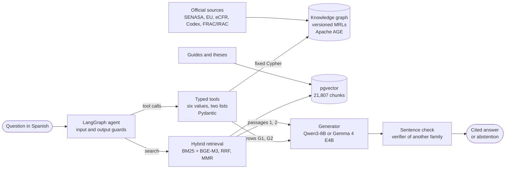

# Phytosanitary Compliance Assistant

**A neurosymbolic system based on retrieval-augmented generation for phytosanitary compliance verification in Peruvian agro-exports.**

Every pesticide applied in the field must be registered in Peru for that crop and pest, and its residue must stay below the
maximum residue limit (MRL) of each destination market, which differs between the EU, the United States and Codex and
changes over time. This system answers those questions with **exact, cited values**, and explains agronomic management
from official guides and university theses, all running **locally on a single 8 GB consumer GPU**.

> The language model never decides compliance. Exact rules over a versioned knowledge graph decide; the model interprets
> the question, calls typed tools, retrieves passages and writes the answer, citing every value it gives.

## Results

Structured compliance questions (110; limits, registrations, pre-harvest intervals, mode of action, market comparisons),
exact answers with the expected value and unit:

| Configuration | Qwen3-8B | Gemma 4 E4B |
|---|---|---|
| **Tools with input and output guards (the system)** | **110 / 110**, 0 invented values | **110 / 110**, 0 invented values |
| Tools with the input guard only | 110 | 108 (2 invented) |
| Tools without guards | 55 (65 invented) | 104 |
| Conventional RAG over the same documents | 2 | 0 |
| Same model from memory | 8 | 7 |

Textual questions (60, one third multi-hop) and spray programs:

| What was measured | Result |
|---|---|
| Hybrid retrieval: a passage that answers among the first 10 | **80 %** (MRR@10 0.78); better than lexical (McNemar p = 0.049), not distinguishable from dense |
| Questions answered with evidence, system vs conventional RAG | **50 vs 36** (McNemar p = 0.009); multi-hop 16 vs 7 (p = 0.012) |
| Faithfulness (RAGAS, per sentence), judge closest to a manual annotation | 0.63; the judge of the generator's own family overrated it by 0.25 |
| Sentence-level check against the cited evidence, by manual annotation of the same 30 questions | Qwen3-8B **0.51 → 0.82** (8 of 30 answers became abstentions); Gemma 4 E4B **0.95** already without it |
| Both reference documents of a multi-hop question among the six passages (graph list in the fusion) | 0 / 14 → **2 / 14** on the test split; useful@10 0.83 → 0.90 |
| Repeatability: the same text when a question is asked twice (18 questions) | Qwen3-8B 5 → **13** with temperature 0 and a fixed seed (p = 0.008); Gemma 4 E4B 7, with 15 of 18 citations repeated |
| Validator on 42 control programs (clean and near misses at the edges of the rules) | **42 / 42**; the same model without the exact core: 11 / 42 (p = 9e-10) |
| Validator on 5 real programs from published theses, against a manual reference | 51 / 54 rows (blocking), 54 / 54 after checking the disputed rows against the official sources |
| The same programs imported from field sheets (Excel, as printed) | 56 / 56 rows resolved and validated as in the evaluation; 13 of 37 comparable doses outside the SIGIA range, 4 of 39 targets without a registration (flags for review) |
| Knowledge graph | 8,840 MRL versions (EU, US, Codex), 3,136 products, 6,688 authorizations, 92 mode-of-action groups |

List and count questions that the six one-value tools cannot answer (which products against a pest fit a pre-harvest
interval, how many ingredients lack a limit in a market), built from the graph with queries of their own:

| Suite | Tools | Qwen3-8B | Gemma 4 E4B |
|---|---|---|---|
| S1b (31 questions) | six | 0 | 0 |
| | eight | 26 | **31** |
| S1b, second suite (31 new questions, after typo-tolerant names) | six | 0 | 0 |
| | eight | 26 | **30** |
| Structured suite (110) with the eight tools | | **110** | **110** |

The two list and count tools are on by default (`orchestration.genericas`): with them both models still answer the 110 structured questions exactly. A first measurement had Qwen3-8B at 109 (a misspelled ingredient); the tools now read misspelled or Spanish ingredient names as the one close ingredient and say so, and the second suite was built after that change, on pests the first did not use.

**Statistics.** `resumen-estadistico` gives Wilson or bootstrap 95 % intervals for the main estimates. A manual review of 20 of the textual questions found all of them
understandable on their own, but the reference passage fully answered only 9.

Every number comes from a run folder in `ml/evaluation/runs/` with its configuration, per-question outputs and metrics.
The texts of the cited corpus passages are not published; the runs keep their references (document and fragment ids),
and the labels of the manual annotations are in `ml/evaluation/suites/anotaciones_manuales.json`.

## How it works



- **Exact core.** Registrations, MRLs and mode-of-action groups are loaded deterministically from dated snapshots of the
  official sources. A limit is never overwritten: each new value is a new version linked by `REPLACES`, so the system
  knows which limit applied on the date of a shipment.
- **Typed tools.** Six tools (limit in force, limit history, market comparison, product registration, pre-harvest interval,
  mode-of-action group) take validated arguments and run fixed, parameterized queries; two more return lists and counts
  (products registered against a pest, filtered by interval, mode-of-action group or market; ingredients without a limit
  in force in a market), with `orchestration.genericas`. The model chooses the tool and its arguments; it never writes a
  query. A misspelled or Spanish ingredient name is read as the one ingredient it is close to, and the result says so.
- **Guards.** A LangGraph state graph does not accept a compliance answer until a tool has been consulted (input guard),
  and sends back once any value in mg/kg or days that no tool returned (output guard).
- **Checks on the answer.** Graph rows are cited as `[G1]` and passages as `[1]`; an answer that cites nothing becomes an
  abstention. Optionally (`orchestration.verificador` in `backend/config/assistant.yaml`), a model of another family labels
  each sentence against what it cites and only supported sentences are kept.
- **Program validator.** A spray program is checked per field block against every target market: registration, MRL,
  pre-harvest interval and mode-of-action rotation, with the source and date of each finding.
- **Field sheets.** `POST /api/programas/importar` (and the program page of the web app) reads an Excel or CSV sheet as
  the farm keeps it, resolves trade names, spellings and growth stages into registered products and dates, never
  replaces an unregistered product, and flags doses outside the registered range and targets without a registration.
- **Web app.** In the assistant, each `[G1]` opens the exact-core row behind it (tool, arguments, value, regulation and
  date) and each `[1]` its passage; the registry filters products by name or ingredient, pre-harvest interval and type
  and exports them; a validation or a lab result exports its findings as CSV or prints as a report.

## Repository layout

| Folder | Contents |
|---|---|
| `backend/` | Python service. `src/` in layers: `domain` (exact rules, no language model), `knowledge` (sources, documents, normalization, graph), `assistant` (retrieval, tools, orchestration and checks, generation), `evaluation` (suites and metrics), `interfaces` (API and batch jobs), `accounts`. |
| `frontend/` | Next.js application, exported as a static site; the same build runs in the browser or as a desktop app. |
| `ml/` | Evaluation suites, relevance judgments, run folders, and the encoder adaptation (LoRA on BGE-M3). |
| `ops/` | Docker image of the database and operation scripts. |

Folders starting with `non_` are not versioned (local data, secrets and notes).

## Quick start

Requirements: Python 3.12 with [uv](https://docs.astral.sh/uv/), Node.js, Docker, and [Ollama](https://ollama.com/) with
`gemma4:e4b` (the default generator), and `qwen3:8b` and `llama3.1:8b` to reproduce the second generator and the judges.

```bash
make db           # PostgreSQL 16 + pgvector + Apache AGE in Docker
make install      # backend environment
make graph        # load the knowledge graph from the official snapshots
make api          # FastAPI on http://localhost:8000
make web          # web app on http://localhost:3000
make test         # backend test suite
```

Ask a question from the command line:

```bash
make preguntar P="¿Qué productos están registrados para Botrytis en arándano y cuál es el LMR de la UE?"
```

## Reproducing the experiments

```bash
cd backend
E="uv run python -m interfaces.jobs.evaluate"
$E cumplimiento-s1 --modo herramientas [--modelo gemma4:e4b]     # structured suite with tools and both guards
$E cumplimiento-s1 --modo sin-guarda | memoria | rag             # ablation and baselines
$E recuperacion-juzgada --ranking idf --mmr 1.0                  # retrieval on the textual suite
$E comparar-recuperacion --corrida <run>                         # paired tests between retrievers
$E fidelidad-s2 [--modelo gemma4:e4b] [--verificador qwen3:8b]   # faithfulness per sentence (and the sentence check)
$E fidelidad-s2 --sistema rag                                    # conventional RAG baseline
$E rejuzgar-s2 --corrida <run> --juez gemma4:e4b                 # the same answers, another judge family
$E sin-verificar --corrida <run>                                 # the answers before the sentence check
$E comparar --s1 <run> --s1-contra <runs> --s2 <run> --s2-contra <run>   # McNemar and Wilcoxon (SciPy)
$E validar-controles                                             # validator on the 42 control programs
$E validar-llm --solo-controles                                  # same model without the exact core
$E validar-reales && $E reales-acuerdo --corrida <run> [--adjudicada]    # real programs vs the manual reference
$E importar-reales                                               # the same programs through the field-sheet import
$E cobertura-documentos --particion prueba --lista-grafo 1       # both documents of multi-hop questions (graph list)
$E repetibilidad-s2 --particion desarrollo [--temperatura 0.1 --semilla -1]   # the same answer twice?
$E suite-s1b && $E cumplimiento-s1 --modo herramientas --suite s1b [--genericas]   # list and count questions
```

Each command writes a new folder in `ml/evaluation/runs/`.

## Data sources

SENASA SIGIA (Peruvian pesticide registry), EU Pesticides Database, 40 CFR Part 180 (eCFR), Codex Alimentarius, FRAC and
IRAC classifications, AGROVOC (FAO, CC BY 4.0), and guides and theses from the SENASA and UNALM repositories. Each source
is stored as a dated snapshot with its manifest and hash.

## Scope

The system informs and cites; it does not replace the product label or the professional who decides. It covers blueberry,
avocado and table grape and three market references (EU, United States, Codex).
